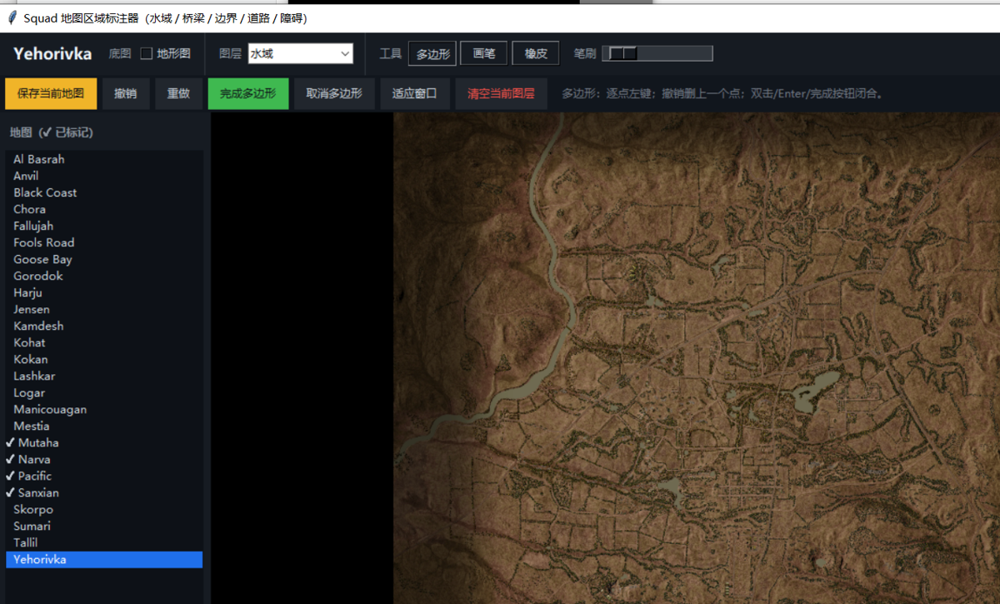

# map-water-bridge-annotator · Squad 地图水域 / 桥梁标注器

给 Squad 的 25 张官方地图**手工补画水域、深水河段、桥梁**的桌面工具。
自动水体识别只认地形图上足够暗的深水，浅滩与可涉水河段会漏；这个标注器让你直接在底图上刷出
"哪里是水、哪里能过桥、哪里算地图边界内、哪条路是通畅道路、哪里绝对过不去、哪片水面能开船"，
输出 2048×2048 的灰度掩膜，交给地图生成器下采样成 1024 栅格后参与通行判定、A\* 路线与视线分析。

Python + tkinter + Pillow + numpy，单文件脚本；Release 里也附了免装 Python 的单文件 exe。



## 下载

| 产物 | 说明 |
| --- | --- |
| `map-water-bridge-annotator.exe` | 单文件 exe（约 32 MB，Windows x64），双击就能开，不需要装 Python / .NET / 任何运行时 |
| `tools/annotate_maps.py` | 同一份工具的源码，`pip install pillow numpy` 后直接跑 |

exe 也在 [Releases](https://github.com/copperbookworm/map-water-bridge-annotator/releases/latest) 里。
**用法：把 exe 放到仓库根目录（和 `tools\` 同级）再双击**，它就以自己所在的文件夹为工作根目录。
exe 没有代码签名，首次运行 Windows 可能弹 SmartScreen / 杀软提示，选“仍要运行”即可。

## 运行

**方式一：exe（推荐，什么都不用装）**

1. 下载本仓库（`Code` → `Download ZIP` 解压，或 `git clone`）；
2. 双击 `start-annotator.bat`：
   - 第一次运行会问要不要下载地图数据（约 175 MB，只需一次，走 Windows 自带的 PowerShell，不需要 Python）；
   - 下完自动打开标注器；之后每次双击就是直接启动。
3. 也可以直接双击 `map-water-bridge-annotator.exe` —— 只要它和 `tools\`、`.tmp\maps_source\` 在同一层就能跑。
   单独一个 exe（旁边没有 `tools\maps_catalog.json`）会弹窗说明缺什么、该放哪，不会静默失败。

**方式二：源码**

```bash
python -m pip install pillow numpy
python tools/annotate_maps.py
```

源码版把**脚本所在目录的上一级**（也就是仓库根）当作工作根目录，克隆下来就能跑。

工作根目录里需要这些：

```
<ROOT>/
  tools/maps_catalog.json          25 张图的名称 / 边界 / 高度缩放（本仓库自带）
  .tmp/maps_source/<slug>/         底图与高程图（需要先下载，见下节）
  annotations/<slug>/*.png         标注输出（自动创建）
```

环境变量 `SQUAD_MAP_ROOT` 可以覆盖工作根目录（`start-annotator.bat` 就是这么做的）。

## 先准备地图源数据

标注器自己不联网，底图和高程图要先用下载脚本抓一次。**PowerShell 版不需要 Python**：

```powershell
powershell -ExecutionPolicy Bypass -File tools\download_maps.ps1
# 只下某几张：
powershell -ExecutionPolicy Bypass -File tools\download_maps.ps1 -Only yehorivka,narva
# 连地图生成器要用的 3D 树一起下（多约 77 MB）：
powershell -ExecutionPolicy Bypass -File tools\download_maps.ps1 -WithTrees
```

装了 Python 也可以用同一套逻辑的 `tools/download_maps.py`：

```bash
python tools/download_maps.py
```

两个脚本都按 `maps_catalog.json` 把 25 张图下载到 `.tmp/maps_source/<slug>/`：

| 文件 | 25 张合计 | 用途 |
| --- | --- | --- |
| `heightmap.png` | 约 65 MB | 高程图（“测高度”工具读它，也是叠图的几何基准） |
| `basemap.webp` | 约 62 MB | 卫星底图，画图的背景 |
| `topomap.webp` | 约 48 MB | 地形图，勾“地形图”时切换成这个背景 |
| `3d/trees.json` + `3d/trees.bin` | 约 77 MB（`-WithTrees` 才下） | 3D 树实例，地图生成器栅格化树冠用 |

只画标注的话前三项共约 175 MB，一次就够。下载源是 `https://squadcalc.app/api` + 每张图的 `path`
（见 `maps_catalog.json`）；已存在且非空的文件会跳过，中断了重跑会接着下。
**这些地图素材的版权归各自所有者**，本仓库只提供下载脚本，不转存任何游戏资产。

## 六个图层

| 图层 | key | 颜色 | 含义 |
| --- | --- | --- | --- |
| 水域 | `water` | 蓝 (35,110,235) | 陆地载具硬障碍；浅滩 / 可涉水河段也画在这里由你决定 |
| 桥梁 | `bridge` | 橙 (255,170,25) | 桥面，绝对可通行（优先于水域判定） |
| 地图边界内 | `boundary` | 绿 (35,210,120) | 图上可玩区域；边界外一律不可通行 |
| 通畅道路 | `clear` | 亮绿 (60,230,100) | 硬质路面 / 铺装地，按豁免规则放行 |
| 不可通行障碍 | `obstacle` | 红 (255,55,110) | 建筑、围墙、水坝等硬阻挡 |
| 水面舰艇航道 | `boat` | 青 (80,190,255) | 水面载具可走的水域 |

每个图层独立一张掩膜，可以同时存在、互不覆盖。切图层 / 切地图 / 关窗口时自动保存。

## 五种工具

| 工具 | 怎么用 |
| --- | --- |
| 多边形 | 逐点点击画多边形，双击或 Enter 闭合；Esc 取消当前绘制 |
| 画笔 | 按住左键刷，滚轮缩放，笔刷半径 1–40 地图像素（状态栏同时显示直径） |
| 橡皮 | 同一支笔，刷掉当前图层的像素 |
| 智能选区 | 点一下底图上的颜色 → 按颜色相似度做 8 邻接区域生长 → 把这一整块变成可编辑多边形，可直接写入当前图层。容差 0–120（默认 16）；可继续点击累加种子（最多 8 个），Ctrl+点击改为从选区里扣掉那一块（挖洞） |
| 测高度 | 点地图任意位置，按 Squad 的高程编码读出海拔：`(255 + R - B) * landscapeScale[2]`（米，相对本图最低点），再加 `maps_catalog.json` 的 `zoff` 得到世界 Z |

智能选区把像素簇转成多边形时会做边界跟踪 + RDP 简化（容差 1.6 px），得到点数不多的干净轮廓，
方便再手动修角点。

## 快捷键

| 键 | 作用 |
| --- | --- |
| `W` `B` `N` `R` `O` `V` | 切到 水域 / 桥梁 / 边界内 / 通畅道路 / 障碍 / 舰艇航道 |
| `P` `G` `E` `S` `H` | 切到 多边形 / 画笔 / 橡皮 / 智能选区 / 测高度 |
| 滚轮 | 以光标为中心缩放 |
| 右键 / 中键拖动 | 平移画布 |
| `Ctrl+Z` / `Ctrl+Y` | 撤销 / 重做 |
| `Ctrl+S` | 立即保存当前图 |
| `Esc` / `Enter` | 取消选区或当前绘制 / 确认闭合 |

## 输出格式

```
annotations/<slug>/water.png      8 位灰度（PIL mode "L"），2048×2048，非 0 表示属于该图层
annotations/<slug>/bridge.png
annotations/<slug>/boundary.png
annotations/<slug>/clear.png
annotations/<slug>/obstacle.png
annotations/<slug>/boat.png
annotations/<slug>/meta.json      { slug, label, size: 2048, updated, tool: "annotate_maps.py/2", layers: [...] }
```

`<slug>` 就是 `maps_catalog.json` 里的 slug（`albasrah`、`gorodok`、`yehorivka` …），
和 [Yehorivka-Passability](https://github.com/copperbookworm/Yehorivka-Passability) 仓库里的
`annotations/` 目录结构完全一致：

- 标注器写 **2048×2048**；
- 地图生成器 `tools/build_maps.py` 读到后下采样到 App 用的 **1024×1024** 栅格，
  并**覆盖**该图层的自动识别结果（人工优先）。

## 接到通行分析流水线

```bash
# 1) 手工标注完，确认 annotations/<slug>/*.png 有内容
# 2) 回到 Yehorivka-Passability 仓库，重生成地图页
python tools/build_maps.py            # 全部 25 张
python tools/build_maps.py --only narva
```

生成器把它们和其它栅格一起内联进单页 HTML（每张图一页），Android App 与桌面浏览器共用。

## 仓库结构

```
map-water-bridge-annotator.exe     免装 Python 的单文件版（放在仓库根目录即可双击运行）
start-annotator.bat                一键启动：设好工作根目录，缺地图数据就先下载
tools/annotate_maps.py             标注器源码（tkinter / Pillow / numpy）
tools/download_maps.ps1            下载地图源数据（纯 PowerShell，免 Python）
tools/download_maps.py             同上，Python 版
tools/maps_catalog.json            25 张图的 slug、边界、高度缩放
docs/annotator.png                 README 截图
```

## 已知限制

- 标注是 2048 栅格上的手工近似，不是逐件模型判定；边缘 1–2 像素的误差会被下采样抹平，也可能吃掉窄桥；
- 画面按底图像素坐标对齐，换底图（卫星 / 地形）不影响标注（同一几何），但**不要**在标注中途换图源分辨率；
- "测高度"依赖 `heightmap.png` 的红 / 蓝通道编码，缺这张图时工具会提示读不到；
- 一张图一张标注，没有图层复制 / 批量迁移功能。


- exe 是未签名的 PyInstaller 单文件包，首次运行可能被杀软 / SmartScreen 拦一下，选“仍要运行”；
- 标注器不联网，地图数据必须先下（`start-annotator.bat` 会自动问你，也可以手动跑 `tools\download_maps.ps1`）。

## 许可证

[MIT](LICENSE) © 2026 copperbookworm

Squad 游戏素材与 squadcalc.app 地图数据的版权归各自所有者，MIT 只覆盖本仓库的代码。

本项目是非官方粉丝工具，与 Offworld Industries 无关。
